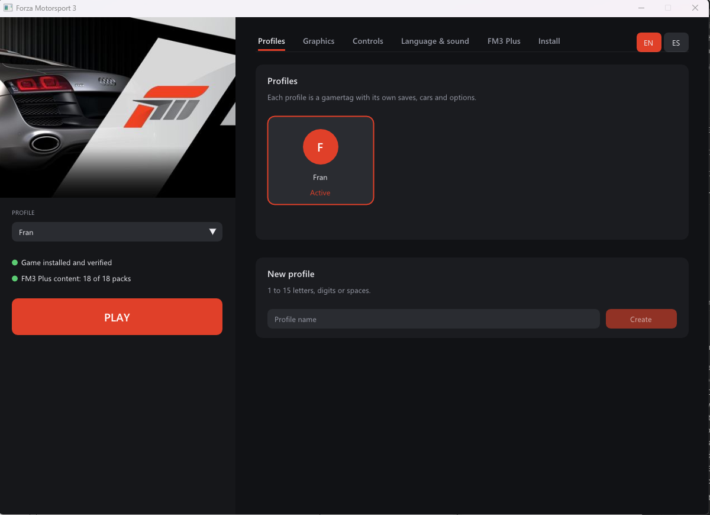
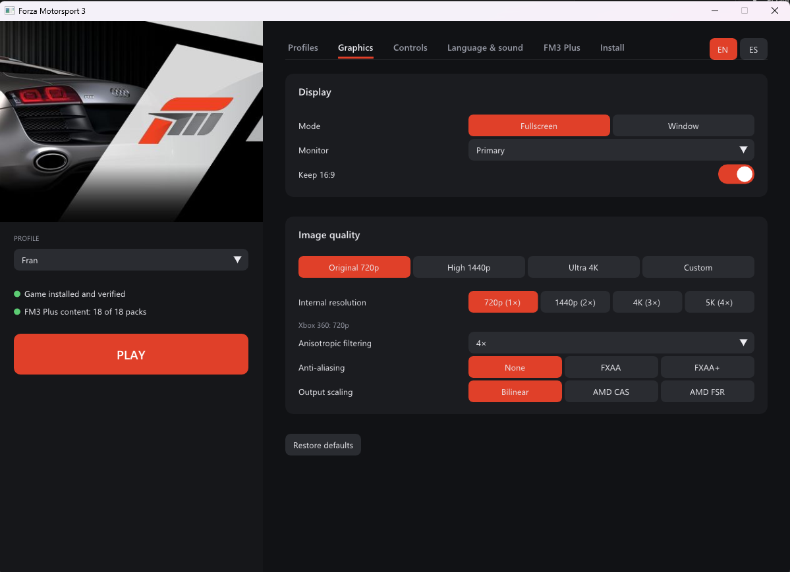
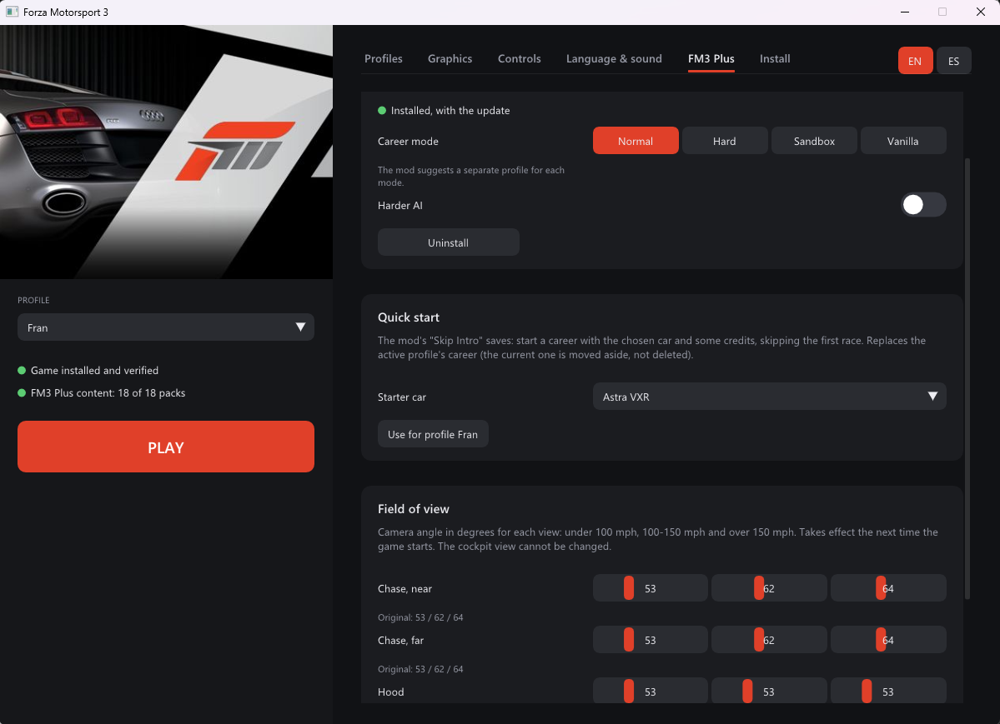
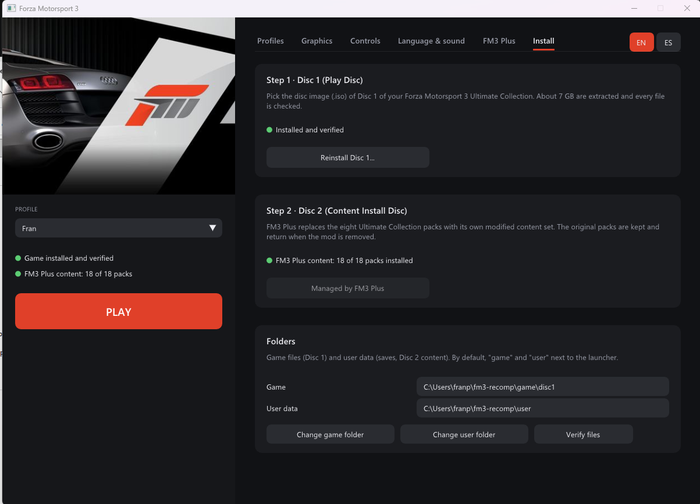

<div align="center">

# Forza Motorsport 3 — Native PC Recompilation

**A work-in-progress static recompilation of the Xbox 360 racing game for modern Windows PCs.**


[](#supported-version)

[Supported version](#supported-version) · [Launcher](#launcher) · [Build from source](#building-from-source) · [Porting notes](#porting-notes)

</div>

A work-in-progress static recompilation of *Forza Motorsport 3: Ultimate Collection* that runs natively on Windows PCs. The Xbox 360 PowerPC code is translated to C++ using the [ReXGlue SDK](https://github.com/rexglue/rexglue-sdk), while the runtime provides the console services required by the game, including graphics, audio, input, profiles, file-system access, and downloadable content.

The project includes its own launcher for installing and verifying both game discs, managing local profiles, configuring the port, and installing Project Forza Plus 3.

> [!IMPORTANT]
> No copyrighted game files are included. You must provide your own original Xbox 360 copies of *Forza Motorsport 3: Ultimate Collection*.

> [!WARNING]
> This project is still under active development. Menus, videos, Free Play, and races are working at 60 FPS, but the full Career mode, local multiplayer, and other game modes still require more testing. Xbox Live is not available.

## Supported version

The only version currently supported is **Forza Motorsport 3: Ultimate Collection (USA)**, Title ID `4D53084D`, Media ID `6F74359D`, with `default.xex` version `0.0.0.8`.

Development and testing are performed with the following exact disc images:

| Disc | Size | MD5 |
|---|---:|---|
| Disc 1 — Play Disc | 7,838,695,424 bytes | `A527154D55C7B39849EC68CD46F17281` |
| Disc 2 — Content Install Disc | 7,838,695,424 bytes | `E65FF1CDC189F3EB9B1D0F14F97BAEA4` |

The MD5 values are provided only to identify the correct disc dumps; they are not intended as cryptographic guarantees. After extracting Disc 1, the launcher also verifies every installed file against `game_files.sha256` using SHA-256. Other regions, editions, or revisions may contain a different executable and are not currently supported.

## Launcher

The launcher is based on the one created for the Forza Motorsport 2 recompilation and uses SDL3, SDL_GPU, and Dear ImGui. Its interface is available in English and Spanish. On first launch it follows the operating-system language, and it can be changed at any time with the EN/ES selector.

| Profiles | Graphics |
|---|---|
|  |  |

| Project Forza Plus 3 | Installation and verification |
|---|---|
|  |  |

### Features

- **Two-disc installation:** the launcher automatically identifies each ISO and guides you through the process.
  1. **Disc 1 — Play Disc:** extracts approximately 7 GB of game data, excluding `$SystemUpdate`, and verifies every file against the SHA-256 manifest.
  2. **Disc 2 — Content Install Disc:** extracts all eight car and track content packages. `fm3tool install-dlc` installs them, including their licence headers, in the format expected by the game.
- **Local profiles:** create, select, and remove named profiles. Each profile has its own offline XUID and separate save directory under `user\<XUID>\...`. Deleted profiles are preserved in `user\deleted-profiles\`.
- **Graphics:** windowed or fullscreen mode, monitor selection, window size, 16:9 output, 720p/1440p/4K presets, 1×–4× internal resolution, anisotropic filtering, FXAA, and Bilinear, AMD CAS, or AMD FSR scaling.
- **Controls:** Xbox and other SDL/XInput-compatible controllers, remappable keyboard controls, and optional mouse input mapped to the right stick.
- **Language and audio:** select the in-game language or mute game audio.
- **Project Forza Plus 3:** install, update, configure, and remove the mod from its ZIP archives. Available options include Career mode selection, harder AI, quick-start saves, and field of view.
- **Shader precompilation:** prepares graphics pipelines before play to reduce first-time stutter.

Direct3D 12 and `readback_resolve = "fast"` are selected automatically. FM3 requires render readback for the road surface and vehicle thumbnails, while the synchronous `full` mode limits the game to 30 FPS. These settings are therefore not exposed in the launcher.

Project Forza Plus 3 supplies an alternative set of 18 content packages. During installation, the launcher safely backs up the eight Ultimate Collection packages and replaces them with the modded set. Removing the mod restores the original packages.

> [!NOTE]
> Keep the user-data path reasonably short. Windows' legacy 260-character path limit applies, and some Disc 2 file names add up to 162 characters. The launcher rejects user-data paths longer than 96 characters.

## Building from source

### Requirements

- Windows 10 or Windows 11, x64
- Visual Studio 2022 Build Tools with MSVC and the Windows SDK
- LLVM/Clang 20 or newer (`winget install LLVM.LLVM`)
- CMake 3.25 or newer
- Ninja
- Git for Windows, with `sh` available on `PATH`

Clone the repository together with its submodules:

```bat
git clone --recursive https://github.com/0herculabs/hl360-forza3.git
cd hl360-forza3
```

Build the SDK once, then build the game, launcher, and supporting tools:

```bat
:: Apply patches\sdk\*.patch and install the SDK into out\install
scripts\build_sdk.cmd

:: Build the game, launcher, and tools into out\build\win-amd64-release
scripts\build.cmd release
```

`scripts\devenv.cmd` loads the MSVC environment and places Clang from `C:\Program Files\LLVM\bin` at the beginning of `PATH`.

Recompiled code is generated in `generated\default\` from `fm3_manifest.toml` and `config\*.toml`. The build system automatically runs the code generator again whenever one of those inputs changes.

## Launcher command line

The launcher also provides non-interactive modes that use the same internal installation and verification paths as the graphical interface:

```bat
fm3-launcher --import-iso <iso> --game-dir <dir> --user-dir <dir> [--log <file>]
fm3-launcher --verify --game-dir <dir> [--log <file>]
fm3-launcher --screenshot <file.bmp> [--tab profiles|graphics|controls|audio|plus|install]
```

## Configuration files

The following files are stored next to `fm3.exe`:

| File | Purpose |
|---|---|
| `fm3.toml` | Default port settings, copied from `config\fm3.toml` during the build |
| `fm3.user.toml` | Player-selected settings, paths, and active profile; written by the launcher and overrides `fm3.toml` |
| `launcher.toml` | Launcher language and profile list |
| `game_files.sha256` | Disc 1 verification manifest generated by `tools\make_manifest.py` |
| `cover.jpg` | Cover artwork extracted from the Disc 1 `nxeart` asset |
| `logs\` | Runtime logs, crash reports, and minidumps |

`fm3.exe` can be launched without command-line arguments and reads these files automatically. While the game is running, F4 opens the SDK cvar editor and F3 opens the debugging overlay.

## Repository layout

| Path | Purpose |
|---|---|
| `fm3_manifest.toml` | ReXGlue manifest defining the input XEX and code-generation output |
| `config/codegen.toml` | Function boundaries, `setjmp`/`longjmp`, and fibre configuration |
| `config/fptr_functions.toml` | Functions reachable only through pointers |
| `config/fm3.toml` | Default settings distributed with the executable |
| `src/` | Game application (`Fm3App`) and crash-reporting code |
| `launcher/` | Graphical launcher and installer |
| `tools/fm3tool/` | ISO/STFS extraction, DLC installation, and XEX dumping |
| `tools/*.py` | Disassembly, function-pointer discovery, and manifest utilities |
| `patches/sdk/` | Project-specific ReXGlue SDK changes |
| `scripts/` | Command-line build and installation scripts |

## Porting notes

- **Code generation:** 15 functions reachable only through tail calls or vtables, plus three getters with a shared epilogue, required explicit function boundaries. `config/fptr_functions.toml` declares roughly 200 functions reached only through pointers such as vtables, callbacks, and thread entries. `tools/find_fptrs.py` finds pointers in `.rdata`/`.data` and `lis`+`addi` pairs; `tools/prune_fptrs.py` removes false positives. If the runtime stops with `Call to invalid or unregistered function at guest address X`, address X is probably missing from this list.
- **Fibres:** XAPI fibres use the native SDK implementation configured under `[rexcrt]`.
- **`setjmp`/`longjmp`:** addresses `0x82534B20` and `0x825345E0` must be declared. Without them, libjpeg error handling corrupts registers and causes a crash when entering a race.
- **`cache:` device:** FM3 writes to paths such as `cache:\replay_stream` during races without mounting the device itself. `Fm3App` mounts it at `user\cache_partition`.
- **Disc 2 content:** installed packages require their licence headers and are registered through the SDK's `ContentManager::InstallContent` implementation.
- **Project Forza Plus 3:** the mod includes 18 pre-extracted content packages. Its `default.xex` belongs to the original 2009 edition and is not used. The port rebuilds the protected-file signature table in memory instead.
- **Render-to-texture:** `readback_resolve = "fast"` is fixed and hidden from the launcher. Readback is required for roads and vehicle thumbnails, whereas `full` is synchronous and caps FM3 at 30 FPS.
- **Frame pacing:** the SDK's `vsync` cvar represents the console vblank timer, not display synchronization. FM3 uses that timer internally and runs too fast without it, so it is fixed in `fm3.toml`. Achievement notifications are also disabled because an active notification causes the presenter to repaint at the monitor refresh rate, resulting in misleadingly high frame counters and severe pacing issues. Synchronous pipeline compilation and `gpu_allow_invalid_fetch_constants` follow the FM2 recompilation settings.
- **Audio:** FM3 submits blocks of only 256 samples, or 5.33 ms at 48 kHz. `audio_maxqframes = 16` gives the audio queue enough headroom to survive brief CPU or GPU stalls without audible SDL underruns, for a maximum buffer of approximately 85 ms.

### ReXGlue SDK patches

The patches under `patches/sdk/` are applied by `scripts\build_sdk.cmd`:

1. `0001-user-profile-setters` — active-profile name and XUID setters.
2. `0002-content-diagnostics` — content enumeration and access diagnostics.
3. `0003-gpu-fixes-from-xenia` — GPU fixes from newer xenia-canary/xenia-edge revisions, primarily addressing FM3's square shadows and road rendering:
   - `d119505`: rescale texture reads that use integer `num_format`.
   - xenia-edge `c0e1129d7`: force the sampler border-colour alpha to 1.
   - xenia-edge `4e2964f85`: use point sampling for formats that do not support linear filtering under D3D12.
   - xenia-edge `9781a75a2`: do not treat a texture with invalidated memory as already loaded.
   - xenia-edge `c02060f22`: downscale resolve readback when the internal resolution is above 1×. The included HLSL and GLSL shaders are rebuilt with Windows SDK `fxc` and `glslangValidator`; the latter can be built with `scripts\build_glslang.cmd`.
   - xenia-edge `2d7ca4fb3`: do not report empty resolves as errors, eliminating approximately 170 unnecessary log messages per second in FM3.

The SDK is built with `REXGLUE_USE_VULKAN=ON`, but the port selects Direct3D 12 because the Vulkan backend does not yet render FM3 correctly.

## Compatibility references

Initial compatibility settings were informed by [xenia-manager/optimized-settings](https://github.com/xenia-manager/optimized-settings) and [xenia-canary compatibility report #409](https://github.com/xenia-canary/game-compatibility/issues/409). Xenia recommends `readback_resolve = "full"` for accuracy; this port uses `fast` because it preserves the readbacks FM3 needs without reducing output to 30 FPS.

The only FM3 entry in `game-patches`, *Disable hash checks*, does not match this Ultimate Collection `default.xex` and is not applied.

## Credits and legal notice

Built with the [ReXGlue SDK](https://github.com/rexglue/rexglue-sdk) and the work of the [Xenia](https://github.com/xenia-project/xenia) and [XenonRecomp](https://github.com/hedge-dev/XenonRecomp) projects.

This is an independent preservation and compatibility project. It is not affiliated with, endorsed by, or sponsored by Microsoft or Turn 10 Studios.

